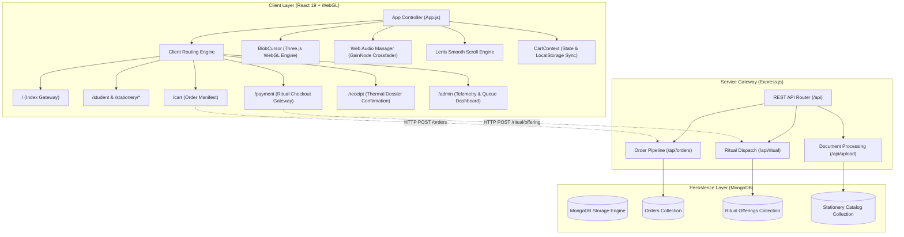
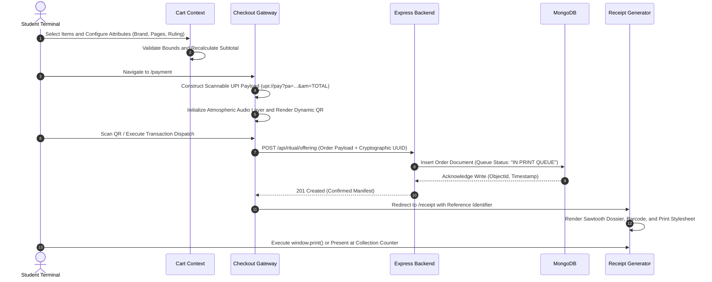

# Odyssey — Campus Stationery and Print Pre-Order Ecosystem

Odyssey is an asynchronous, high-volume campus stationery requisition and document print pre-ordering platform. Designed to eliminate physical service bottlenecks in university libraries and print centers, it unifies student order dispatch, client-side dynamic payment verification, and real-time administrative queue management into a performant web architecture.

---

## Technical Specifications

| Subsystem | Core Technologies | Primary Responsibilities |
| :--- | :--- | :--- |
| **Frontend Client** | React 19, React Router v6 | Modular SPA with zero cumulative layout shift (CLS = 0) and route-isolated state management |
| **Graphics Engine** | Three.js (WebGL), Cumulative SVG | Route-aware liquid cursor physics simulation, dynamic refraction, and non-rasterized vector backgrounds |
| **Audio Pipeline** | Web Audio API | Low-latency audio crossfading, route-specific soundscapes, and persistent volume control |
| **Scroll Architecture** | Lenis | Fluid inertia scrolling with viscous resistance across deep document views |
| **Backend Gateway** | Node.js, Express | RESTful routing, document ingestion, and payload serialization |
| **Persistence Layer** | MongoDB, Mongoose | Relational-modeled NoSQL persistence for orders, inventory schemas, and audit logs |

---

## Architectural Overview

The system is organized into a modular layered architecture separating the WebGL visual presentation layer, the application state engine, the HTTP API gateway, and the database persistence tier:



---

## Order and Transaction Lifecycle

The order pipeline enforces strict validation at every phase, from dynamic price calculation to client-side QR generation and thermal confirmation:



---

## Route Harmonization and Display Configurations

To guarantee high visual contrast and distinct atmospheric identities across each aisle, routes utilize dedicated color palettes and physics parameters:

| Route | Functional Module | Background Fill | Accent Color | Cursor Color | Cursor Configuration |
| :--- | :--- | :--- | :--- | :--- | :--- |
| `/` | System Landing | `#9DE869` | `#FF1A8C` | `#FF70A6` | Material: Chrome, Wobble: `0.80`, Splashes: `6` |
| `/student` | Student Basecamp | `#9DE869` | `#0D0D0D` | `#FF70A6` | Material: Chrome, Wobble: `0.85`, Splashes: `7` |
| `/printing` | High-Volume Print Lab | `#019E70` | `#00E599` | `#00E599` | Material: Chrome, Viscous Trail: `12` |
| `/writing` | Writing Instruments | `#019E70` | `#CCFB9A` | `#45B89E` | Material: Jade Chrome, Morph Speed: `0.6` |
| `/stationery/correction` | Correction and Marking | `#2D114D` | `#FFA012` | `#FFA012` | Material: Amber Chrome, High Contrast |
| `/paper` | Paper and Reams | `#140507` | `#FF3B47` | `#FF3B47` | Material: Crimson Chrome, Trail: `14` |
| `/measuring` | Drafting and Geometry | `#1E1B18` | `#F56234` | `#F56234` | Material: Bronze Chrome, Low Wobble |
| `/stationery/office` | Desk and Fasteners | `#181513` | `#C89F72` | `#C89F72` | Material: Gold Chrome, Damped Inertia |
| `/payment` | Checkout and Payment | `#192024` | `#B8281E` | `#FF2A1B` | Material: Flame Chrome, Splashes: `8` |
| `/admin` | Telemetry Dashboard | `#0A0D10` | `#7C5CFC` | `#7C5CFC` | Material: Violet Chrome, Tactical Damping |

---

## Subsystem Implementations

### Liquid Three.js Cursor Engine
- **Physics Modeling**: Implements spring-damper equations calculating instantaneous mouse acceleration, stretching the geometry along the velocity vector.
- **Surface Tension**: WebGL shaders evaluate continuous wobble displacement maps simulating gelatinous surface tension.
- **Droplet Bursts**: High-velocity mouse flicks and clicks trigger directional droplet separation particles with autonomous decay lifecycles.
- **Selection Isolation**: Globally protects interface elements with non-selectable states to prevent accidental text selection during fluid interactions.

### Zero Cumulative Layout Shift (CLS = 0)
- **Dimensional Locking**: Product cards are locked to explicit dimensions (`660px` width, `505px` height) with fixed internal flex structures.
- **Horizontal Overflow Controls**: Option selectors enforce `flex-wrap: nowrap` with invisible touch-scrollable chip containers to prevent multi-line reflow.
- **SVG ViewBox Clamping**: Backgrounds use strict coordinate boundaries (`0 0 1024 576` and `0 0 935 1024`) with `object-fit: cover` and fixed aspect ratios.

### Thermal Dossier Confirmation
- **Sawtooth Separation**: The lower tear edge of the physical receipt is simulated using pure CSS `clip-path: polygon(...)` sawtooth calculations.
- **Algorithmic Barcode**: Generates visual barcode elements via randomized optical stripe widths mapped to the order's unique alphanumeric hash.
- **Print Optimization**: Integrates `@media print` directives stripping ambient backgrounds and framing for clean paper output.

---

## RESTful API Documentation

| Method | Endpoint | Description | Request Payload | Response Status |
| :--- | :--- | :--- | :--- | :--- |
| `GET` | `/api/orders` | Retrieve comprehensive order queue | None | `200 OK` (Array) |
| `POST` | `/api/orders` | Register new student order manifest | `{ studentId, items, total, notes }` | `201 Created` |
| `GET` | `/api/orders/:id` | Fetch specific order metadata | None | `200 OK` (Object) |
| `PATCH` | `/api/orders/:id/status`| Update production status in queue | `{ status: "PRINTING" \| "READY" }` | `200 OK` |
| `POST` | `/api/ritual/offering` | Commit verified payment transaction | `{ orderRef, amount, upiId, timestamp }` | `201 Created` |
| `GET` | `/api/ritual/telemetry`| Aggregate active transaction telemetry| None | `200 OK` |

---

## Detailed Directory Organization

```
Odyssey/
|-- backend/
|   |-- config/
|   |   |-- db.js                  # MongoDB Mongoose connection handler
|   |   `-- multer.js              # Multer configuration for file uploads
|   |-- controllers/
|   |   |-- messageController.js   # Chat dispatch and user messaging logic
|   |   `-- orderController.js     # Order placement, queue status updates, and queries
|   |-- data/
|   |   `-- stationeryData.js      # Seed datasets for stationery inventory catalog
|   |-- middleware/
|   |   `-- uploadProfile.js       # Disk storage and validation for profile images
|   |-- models/
|   |   |-- Message.js             # Mongoose schema for dispatch messaging records
|   |   |-- Order.js               # Primary order schema (items, pricing, queue state)
|   |   `-- User.js                # Student and administrative user schema
|   |-- routes/
|   |   |-- messageRoutes.js       # Endpoints for real-time order chat messages
|   |   |-- orderRoutes.js         # Order dispatch, retrieval, and queue management APIs
|   |   |-- profileRoutes.js       # Student profile and avatar management endpoints
|   |   |-- ritualRoutes.js        # Checkout transaction verification and telemetry
|   |   |-- stationeryRoutes.js    # Catalog queries for product aisles and brands
|   |   `-- uploadRoutes.js        # Document ingestion pipeline for print files
|   |-- server.js                  # Express application entrypoint and middleware orchestration
|   `-- package.json               # Backend dependencies (Express, Mongoose, Multer, CORS)
|-- frontend/
|   |-- public/
|   |   |-- *.svg                  # Cumulative vector landscapes (graveyard, paper, office)
|   |   |-- *.mp3                  # Ambient audio soundscapes (cthulhu, landing, chapel)
|   |   |-- *.mp4                  # Hardware-accelerated intro cinematic videos
|   |   `-- index.html             # Document shell, viewport settings, and web font links
|   `-- src/
|       |-- components/
|       |   |-- BlobCursor.jsx     # WebGL Three.js liquid chrome cursor with fluid dynamics
|       |   |-- BlobCursor.css     # Layering and pointer-events rules for cursor canvas
|       |   |-- ChatBox.jsx        # Order dispatch communication drawer
|       |   |-- ElasticMesh.jsx    # Canvas elastic deformation mesh controller
|       |   |-- ElasticMesh.css    # Layout and z-index controls for mesh canvas
|       |   |-- MusicWaveIcon.jsx  # SVG animated equalizers for audio playback indicators
|       |   |-- OccultCursorFumes.jsx # Particle trail effects for ritual payment views
|       |   |-- PhoneChatDispatch.jsx # Mobile-responsive notification dispatch modal
|       |   |-- ProtectedRoute.js  # Role-based route guard for administrative views
|       |   |-- ScrollFloat.jsx    # Floating action elements with scroll-triggered transforms
|       |   |-- SmoothScroll.jsx   # Lenis smooth scroll provider wrapping application views
|       |   `-- SoundToggleButton.jsx # Global soundscape mute/unmute control with state persistence
|       |-- context/
|       |   `-- CartContext.js     # Global cart state, item mutations, and localStorage sync
|       |-- pages/
|       |   |-- AdminDashboard.js  # Film Noir library administration and print queue monitor
|       |   |-- AdminIntroPage.jsx # Gateway landing for administrative staff
|       |   |-- CartPage.jsx       # Order manifest verification and checkout routing
|       |   |-- ConfirmOrder.jsx   # Intermediate order verification view
|       |   |-- Correction.jsx     # Requisition aisle: Twilight correction and highlighters
|       |   |-- IntroPage.jsx      # Arcade landing screen with expandable aisle accordion
|       |   |-- Measuring.jsx      # Requisition aisle: Drafting rulers and geometry instruments
|       |   |-- Office.jsx         # Requisition aisle: Fasteners, desk organizers, and clips
|       |   |-- Paper.jsx          # Requisition aisle: Specialized reams and notebook bindings
|       |   |-- PaymentPage.jsx    # Gothic ritual checkout shrine with dynamic UPI QR
|       |   |-- PrintPage.jsx      # High-volume document upload, page count, and layout config
|       |   |-- ProfilePage.jsx    # Student history, active order tokens, and receipt archives
|       |   |-- ReceiptPage.jsx    # Thermal dossier receipt with barcode and print styles
|       |   |-- RitualOfferingPage.jsx # Occult ritual tribute confirmation ceremony
|       |   |-- StationeryPage.js  # Unified catalog view across multiple product categories
|       |   |-- UploadOrder.js     # Basecamp Student Desk 04 order staging area
|       |   `-- Writing.jsx        # Requisition aisle: Pens, micro-tips, and ink cartridges
|       |-- utils/
|       |   |-- audioManager.js    # Ambient soundtrack manager with gain crossfades
|       |   |-- paymentAudioManager.js # Payment shrine audio controller and sound triggers
|       |   `-- printReceipt.js    # Print preview generation and thermal styling formatters
|       |-- App.js                 # Central router and dynamic route-to-cursor config mapper
|       |-- index.css              # Neo-brutalist theme tokens, typography, and base CSS
|       `-- index.js               # React 19 root mounting and DOM initialization
|-- .gitignore                     # Git tracking exclusions
`-- start.bat                      # Dual-launch automation for backend and frontend servers
```

---

## Installation and Local Setup

### System Prerequisites
- **Node.js**: Version 18.0.0 or higher
- **npm** or **yarn**
- **MongoDB**: Active instance running locally (`mongodb://127.0.0.1:27017`) or remote connection string

### Quick Initialization
Execute the dual launch batch script from the project root:

```cmd
.\start.bat
```

This starts:
- Backend API Server: `http://localhost:5000`
- Frontend Client Application: `http://localhost:3000`

### Manual Execution

1. **Clone the Repository**:
   ```bash
   git clone https://github.com/imMohammedSahil/Odyssey.git
   cd Odyssey
   ```

2. **Initialize Backend**:
   ```bash
   cd backend
   npm install
   npm start
   ```

3. **Initialize Frontend**:
   ```bash
   cd ../frontend
   npm install
   npm start
   ```

4. **Verify Application Endpoints**:
   - Student Interface: `http://localhost:3000/student`
   - Payment Interface: `http://localhost:3000/payment`
   - Receipt Confirmation: `http://localhost:3000/receipt`
   - Admin Telemetry Dashboard: `http://localhost:3000/admin`


