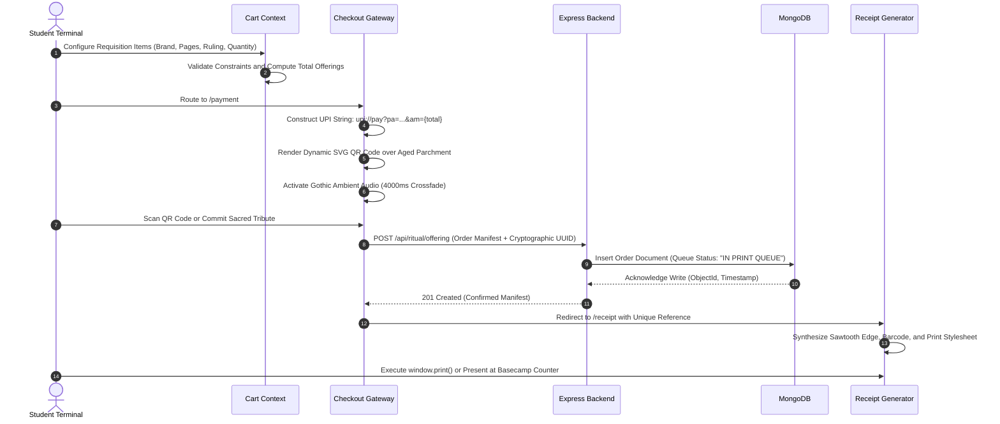

# Odyssey

**Halloween-Themed Campus Stationery Requisition & Document Print Pre-Order Platform**

> Live Application: [odyssey-official.vercel.app](https://odyssey-official.vercel.app)  
> API Service: [odyssey-backend-e0fx.onrender.com](https://odyssey-backend-e0fx.onrender.com)

Odyssey is an asynchronous, high-throughput campus stationery requisition and document print pre-ordering platform engineered to eliminate physical service bottlenecks in university libraries and print centers. Wrapped in an immersive Halloween-inspired visual universe—featuring moonlit gothic cemeteries, hooded reaper ritual shrines, haunted ink labs, and pulp horror comic aesthetics—Odyssey unifies student order dispatch, real-time client-side UPI payment verification, WebGL spatial physics, and administrative telemetry into a performant, zero-layout-shift web ecosystem.

---

## Architectural Specification

| Dimension | Specification | Engineering Context |
| :--- | :--- | :--- |
| **Client Framework** | React 19 / React Router v6 | Single-page reactive application with route-isolated state management and zero layout shift |
| **Graphics Subsystem** | Three.js (WebGL) / HTML5 Canvas | Real-time liquid chrome cursor physics, velocity deformation, and surface tension shaders |
| **Vector Engine** | Cumulative Stacking SVG | Multi-tiered luminance threshold slicing rendering solid vector silhouettes without raster artifacts |
| **Audio Subsystem** | Web Audio API (GainNode Engine) | Low-latency exponential crossfading, route-specific atmospheric soundscapes, and state persistence |
| **Inertia Scrolling** | Lenis Scroll Engine | Fluid inertia scrolling with viscous resistance across deep document views |
| **API Runtime** | Node.js (v18+) / Express 4.x | Asynchronous REST API gateway handling order pipelines, file ingestion, and telemetry dispatch |
| **Persistence Engine** | MongoDB (v6+) / Mongoose 8.x | Document datastore for student manifests, order lifecycle queues, and inventory catalogs |
| **QR Dispatch Engine** | Dynamic Client-Side SVG QR | Instant client-side UPI string compilation mapped dynamically to variable cart totals |
| **Print Output Engine** | CSS Thermal Polygon / `@media print` | Pure CSS sawtooth paper tear (`clip-path`), procedural barcode synthesis, and print stylesheets |
| **Design Paradigm** | Neo-Brutalist / Mignola Black Inking | Heavy 3.5px solid black framing (`#0D0D0D`), hard drop shadows, and high-contrast atmospheric palettes |

---

## System Architecture

The following diagram illustrates the component topology and data lifecycle across the WebGL presentation layer, application state controllers, HTTP API gateway, and database persistence tier:

```mermaid
flowchart TD
    subgraph ClientTier ["Client Tier (React 19 SPA + WebGL Engine)"]
        direction TB
        AppShell["Application Controller (App.js)"]
        Router["Client Routing Engine (React Router v6)"]
        BlobCursor["WebGL Liquid Cursor (Three.js Spring Physics)"]
        AudioEng["Web Audio Manager (GainNode Crossfader)"]
        ScrollEng["Lenis Smooth Scroll Engine"]
        CartStore["CartContext (State Machine & LocalStorage Sync)"]
        
        AppShell --- Router
        AppShell --- BlobCursor
        AppShell --- AudioEng
        AppShell --- ScrollEng
        AppShell --- CartStore
        
        Router --> P_Intro["/ (Index Gateway & Aisle Accordion)"]
        Router --> P_Student["/student (Basecamp Staging Area)"]
        Router --> P_Aisles["/stationery/* (Writing, Correction, Paper, Measuring, Office)"]
        Router --> P_Print["/printing (High-Volume Document Upload)"]
        Router --> P_Cart["/cart (Order Manifest Verification)"]
        Router --> P_Payment["/payment (Gothic Ritual Checkout Gateway)"]
        Router --> P_Receipt["/receipt (Thermal Dossier Confirmation)"]
        Router --> P_Admin["/admin (Telemetry Control & Print Queue)"]
    end

    subgraph ServiceTier ["Service Tier (Express.js REST Gateway)"]
        direction TB
        APIRouter["Express API Router (/api)"]
        OrderController["Order Controller (orderController.js)"]
        RitualController["Ritual Telemetry Dispatch (ritualRoutes.js)"]
        UploadController["File Ingestion Engine (uploadRoutes.js)"]
        MessageController["Dispatch Messaging (messageController.js)"]
        
        APIRouter --> OrderController
        APIRouter --> RitualController
        APIRouter --> UploadController
        APIRouter --> MessageController
    end

    subgraph PersistenceTier ["Persistence Tier (MongoDB)"]
        direction TB
        Database[("MongoDB Storage Engine")]
        Col_Orders[("Orders Collection")]
        Col_Users[("Users Collection")]
        Col_Messages[("Messages Collection")]
        Col_Inventory[("Stationery Catalog")]
        
        OrderController --> Col_Orders
        OrderController --> Col_Users
        RitualController --> Col_Orders
        MessageController --> Col_Messages
        UploadController --> Col_Inventory
    end

    P_Cart -. "HTTP POST /api/orders" .-> OrderController
    P_Payment -. "HTTP POST /api/ritual/offering" .-> RitualController
    P_Admin -. "HTTP GET /api/orders (Queue Sync)" .-> OrderController
```



---

## Order and Transaction Lifecycle

The order pipeline enforces strict validation at every stage, from dynamic cart calculation to client-side QR generation, database write acknowledgment, and thermal receipt rendering:



---

## Core Subsystems and Technical Implementations

### 1. WebGL Liquid Chrome Cursor Engine (`BlobCursor.jsx`)
The application features a continuous Three.js liquid chrome cursor that adapts its physical behavior dynamically across routes:
- **Spring-Damper Simulation**: Instantaneous mouse velocity is calculated on each frame, computing directional elongation (`stretch`), inertial drag (`goo`), and deceleration lag.
- **Surface Tension Modeling**: Dynamic vertex displacement shaders evaluate a continuous mathematical noise function, creating organic wobbling and gelatinous rippling.
- **Particle Droplet Shedding**: When cursor acceleration exceeds velocity thresholds or during mouse clicks, autonomous droplets detach, inherit fractional momentum, and decay over a timed lifecycle.
- **Anti-Selection Protection**: Custom pointer event intercepts and global `user-select: none` boundaries prevent accidental text selection during multi-click interactions.

### 2. Cumulative Vector Stacking Engine
Traditional SVG conversion often traces disconnected contour loops with `fill-rule="evenodd"`, producing hollow wireframe artifacts resembling X-ray scans. Odyssey uses a custom Python vectorization pipeline enforcing cumulative back-to-front threshold stacking:
1. **Luminance Stratification**: Source artwork is analyzed into progressive luminance thresholds (`gray < threshold_distant`, `gray < threshold_mid`, `gray < threshold_near`).
2. **Solid Foreground Inking**: High-density architectural structures and framing elements are clamped to 100% solid, opaque Void Black (`#0D0D0D`).
3. **Continuous Radial Blends**: Fog, lantern glow, and ambient lighting are mapped through multi-tier elliptical radial gradients, eliminating hard rectangular clipping boundaries.

### 3. Client-Side Dynamic UPI QR Generator (`PaymentPage.jsx`)
- Computes scannable National Payments Corporation of India (NPCI) UPI payloads dynamically from current cart totals:
  ```
  upi://pay?pa=odysseycampus@upi&pn=Odyssey%20Campus%20Print&am=${total}&cu=INR
  ```
- Renders the QR code directly into pure vector SVG via client-side matrix calculation.
- Blends the output onto an aged parchment scroll utilizing CSS `mix-blend-mode: multiply`, ensuring the QR code appears organically inked into the parchment texture.

### 4. Thermal Sawtooth Receipt Engine (`ReceiptPage.jsx`)
- **Sawtooth Separation**: Simulates physical POS thermal printer paper tears using CSS polygon clip-paths:
  ```css
  clip-path: polygon(0% 0%, 100% 0%, 100% calc(100% - 10px), 98% 100%, 96% calc(100% - 10px), ...);
  ```
- **Procedural Barcode Synthesis**: Generates an optical barcode from the order's unique hexadecimal hash, rendering randomized vertical stripe weights via pure CSS flexbox elements.
- **Print Stylesheet Isolation**: Custom `@media print` directives strip navigation bars, ambient sound toggles, and dark backgrounds, delivering high-contrast black-and-white output on standard physical printers.

### 5. Web Audio Soundscape Crossfader (`audioManager.js`)
- Employs the Web Audio API (`AudioContext`) with dedicated `GainNode` audio routing graphs.
- Manages dual concurrent audio streams (ambient landing tracks and gothic payment soundscapes) with exponential volume crossfades over 4000ms transitions.
- Persists user mute preferences across browser refreshes via local state flags.

### 6. Zero Cumulative Layout Shift Architecture (CLS = 0)
- **Locked Card Boundaries**: Catalog cards enforce strict dimensional bounds (`660px` width, `505px` locked height) across all product categories.
- **Non-Wrapping Flex Containers**: Option chips enforce `flex-wrap: nowrap` with invisible horizontal scrollbars (`scrollbar-width: none`), preventing multi-line reflow when toggling product variants.
- **Font Fallback Integrity**: Product titles and Indian Rupee symbols (`₹`) utilize explicit multi-tier font fallbacks (`'Archivo Black', 'Plus Jakarta Sans', sans-serif`) to eliminate glyph-substitution layout shifts.

---

## Route Harmonization and Spatial Aesthetics

| Route | Functional Module | Background Fill | Accent Color | Cursor Color | Physics Profile |
| :--- | :--- | :--- | :--- | :--- | :--- |
| `/` | System Landing | `#9DE869` | `#FF1A8C` | `#FF70A6` | Material: Chrome, Wobble: `0.80`, Splashes: `6` |
| `/student` | Student Basecamp | `#9DE869` | `#0D0D0D` | `#FF70A6` | Material: Chrome, Wobble: `0.85`, Splashes: `7` |
| `/printing` | High-Volume Print Lab | `#019E70` | `#00E599` | `#00E599` | Material: Chrome, Viscous Trail: `12` |
| `/writing` | Writing Instruments | `#019E70` | `#CCFB9A` | `#45B89E` | Material: Jade Chrome, Morph Speed: `0.6` |
| `/stationery/correction` | Correction and Marking | `#2D114D` | `#FFA012` | `#FFA012` | Material: Amber Chrome, High Contrast |
| `/paper` | Paper and Reams | `#140507` | `#FF3B47` | `#FF3B47` | Material: Crimson Chrome, Trail: `14` |
| `/measuring` | Drafting and Geometry | `#1E1B18` | `#F56234` | `#F56234` | Material: Bronze Chrome, Low Wobble |
| `/stationery/office` | Desk and Fasteners | `#181513` | `#C89F72` | `#C89F72` | Material: Gold Chrome, Damped Inertia |
| `/payment` | Checkout and Payment | `#192024` | `#B8281E` | `#FF2A1B` | Material: Flame Chrome, Splashes: `8` |
| `/admin` | Telemetry Dashboard | `#0A0D10` | `#7C5CFC` | `#7C5CFC` | Material: Violet Chrome, Tactical Damping |

---

## RESTful API Documentation

| Method | Endpoint | Description | Request Payload | Response Schema |
| :--- | :--- | :--- | :--- | :--- |
| `GET` | `/api/orders` | Retrieve comprehensive order queue telemetry | None | `200 OK` (Array of Order Objects) |
| `POST` | `/api/orders` | Register new student order manifest | `{ studentId, items, total, notes }` | `201 Created` (`{ success: true, order }`) |
| `GET` | `/api/orders/:id` | Fetch specific order manifest by identifier | None | `200 OK` (Order Object) |
| `PATCH` | `/api/orders/:id/status`| Update order status in library queue | `{ status: "PRINTING" \| "READY" }` | `200 OK` (`{ success: true, updated }`) |
| `POST` | `/api/ritual/offering` | Commit verified checkout transaction | `{ orderRef, amount, upiId, timestamp }` | `201 Created` (`{ verified: true, token }`) |
| `GET` | `/api/ritual/telemetry`| Fetch active transaction throughput metrics | None | `200 OK` (`{ count, volume, latency }`) |
| `POST` | `/api/messages/send` | Dispatch communication message for order | `{ orderId, sender, text }` | `201 Created` (Message Object) |
| `GET` | `/api/messages/:orderId`| Retrieve dispatch thread for active order | None | `200 OK` (Array of Message Objects) |

---

## Detailed Directory Organization

```
Odyssey/
|-- backend/
|   |-- config/
|   |   |-- db.js                  # MongoDB Mongoose connection handler
|   |   `-- multer.js              # Multer configuration for document file ingestion
|   |-- controllers/
|   |   |-- messageController.js   # Chat dispatch and user messaging logic
|   |   `-- orderController.js     # Order placement, queue status updates, and queries
|   |-- data/
|   |   `-- stationeryData.js      # Seed datasets for stationery inventory catalog
|   |-- middleware/
|   |   `-- uploadProfile.js       # Disk storage and validation for profile assets
|   |-- models/
|   |   |-- Message.js             # Mongoose schema for dispatch messaging records
|   |   |-- Order.js               # Primary order schema (items, pricing, queue state)
|   |   `-- User.js                # Student and administrative user schema
|   |-- routes/
|   |   |-- messageRoutes.js       # Endpoints for real-time order chat messages
|   |   |-- orderRoutes.js         # Order dispatch, retrieval, and queue management APIs
|   |   |-- profileRoutes.js       # Student profile and avatar management endpoints
|   |   |-- ritualRoutes.js        # Checkout transaction verification and telemetry
|   |   |-- stationeryRoutes.js    # Catalog queries for product aisles and brands
|   |   `-- uploadRoutes.js        # Document ingestion pipeline for print files
|   |-- server.js                  # Express application entrypoint and middleware orchestration
|   `-- package.json               # Backend dependencies (Express, Mongoose, Multer, CORS)
|-- frontend/
|   |-- public/
|   |   |-- *.svg                  # Cumulative vector landscapes (graveyard, paper, office)
|   |   |-- *.mp3                  # Ambient audio soundscapes (cthulhu, landing, chapel)
|   |   |-- *.mp4                  # Hardware-accelerated intro cinematic videos
|   |   `-- index.html             # Document shell, viewport settings, and web font links
|   `-- src/
|       |-- components/
|       |   |-- BlobCursor.jsx     # WebGL Three.js liquid chrome cursor with fluid dynamics
|       |   |-- BlobCursor.css     # Layering and pointer-events rules for cursor canvas
|       |   |-- ChatBox.jsx        # Order dispatch communication drawer
|       |   |-- ElasticMesh.jsx    # Canvas elastic deformation mesh controller
|       |   |-- ElasticMesh.css    # Layout and z-index controls for mesh canvas
|       |   |-- MusicWaveIcon.jsx  # SVG animated equalizers for audio playback indicators
|       |   |-- OccultCursorFumes.jsx # Particle trail effects for ritual payment views
|       |   |-- PhoneChatDispatch.jsx # Mobile-responsive notification dispatch modal
|       |   |-- ProtectedRoute.js  # Role-based route guard for administrative views
|       |   |-- ScrollFloat.jsx    # Floating action elements with scroll-triggered transforms
|       |   |-- SmoothScroll.jsx   # Lenis smooth scroll provider wrapping application views
|       |   `-- SoundToggleButton.jsx # Global soundscape mute/unmute control with state persistence
|       |-- context/
|       |   `-- CartContext.js     # Global cart state, item mutations, and localStorage sync
|       |-- pages/
|       |   |-- AdminDashboard.js  # Film Noir library administration and print queue monitor
|       |   |-- AdminIntroPage.jsx # Gateway landing for administrative staff
|       |   |-- CartPage.jsx       # Order manifest verification and checkout routing
|       |   |-- ConfirmOrder.jsx   # Intermediate order verification view
|       |   |-- Correction.jsx     # Requisition aisle: Twilight correction and highlighters
|       |   |-- IntroPage.jsx      # Arcade landing screen with expandable aisle accordion
|       |   |-- Measuring.jsx      # Requisition aisle: Drafting rulers and geometry instruments
|       |   |-- Office.jsx         # Requisition aisle: Fasteners, desk organizers, and clips
|       |   |-- Paper.jsx          # Requisition aisle: Specialized reams and notebook bindings
|       |   |-- PaymentPage.jsx    # Gothic ritual checkout shrine with dynamic UPI QR
|       |   |-- PrintPage.jsx      # High-volume document upload, page count, and layout config
|       |   |-- ProfilePage.jsx    # Student history, active order tokens, and receipt archives
|       |   |-- ReceiptPage.jsx    # Thermal dossier receipt with barcode and print styles
|       |   |-- RitualOfferingPage.jsx # Occult ritual tribute confirmation ceremony
|       |   |-- StationeryPage.js  # Unified catalog view across multiple product categories
|       |   |-- UploadOrder.js     # Basecamp Student Desk 04 order staging area
|       |   `-- Writing.jsx        # Requisition aisle: Pens, micro-tips, and ink cartridges
|       |-- utils/
|       |   |-- audioManager.js    # Ambient soundtrack manager with gain crossfades
|       |   |-- paymentAudioManager.js # Payment shrine audio controller and sound triggers
|       |   `-- printReceipt.js    # Print preview generation and thermal styling formatters
|       |-- App.js                 # Central router and dynamic route-to-cursor config mapper
|       |-- index.css              # Neo-brutalist theme tokens, typography, and base CSS
|       `-- index.js               # React 19 root mounting and DOM initialization
`-- .gitignore                     # Git tracking exclusions
```

---

## Environment Configuration

Configure the application by establishing environment configurations within the respective modules:

### Backend Configuration (`backend/.env`)

| Variable | Type | Default | Description |
| :--- | :--- | :--- | :--- |
| `PORT` | Number | `5000` | Port on which the Express REST API listens |
| `MONGO_URI` | String | `mongodb://127.0.0.1:27017/campuscart` | Connection URI for the MongoDB database instance |
| `CORS_ORIGIN`| String | `http://localhost:3000` | Permitted client origin for cross-origin resource sharing |

### Frontend Configuration (`frontend/.env`)

| Variable | Type | Default | Description |
| :--- | :--- | :--- | :--- |
| `REACT_APP_API_URL` | String | `http://localhost:5000` | Target base URL for backend API requests |

---

## Local Installation and Execution

### System Prerequisites
- **Node.js**: Version 18.0.0 or higher
- **npm** or **yarn**
- **MongoDB**: Active MongoDB service running locally or accessible via MongoDB Atlas

### Step-by-Step Setup

1. **Clone the repository**:
   ```bash
   git clone https://github.com/imMohammedSahil/Odyssey.git
   cd Odyssey
   ```

2. **Install and run the Backend**:
   ```bash
   cd backend
   npm install
   npm start
   ```

3. **Install and run the Frontend**:
   ```bash
   cd ../frontend
   npm install
   npm start
   ```

4. **Access Core Interfaces**:
   - Primary Landing Screen: `http://localhost:3000`
   - Student Requisition Basecamp: `http://localhost:3000/student`
   - Gothic Payment Shrine: `http://localhost:3000/payment`
   - Order Receipt Confirmation: `http://localhost:3000/receipt`
   - Administrative Telemetry Dashboard: `http://localhost:3000/admin`

---

## Production Deployment Architecture

### Frontend Deployment (Vercel or Netlify)
1. Connect the GitHub repository to the hosting provider.
2. Designate the **Root Directory** as `frontend`.
3. Set the build command to `npm run build` with the output directory set to `build`.
4. Define the production environment variable:
   ```
   REACT_APP_API_URL = https://your-backend-domain.com
   ```

### Backend Deployment (Render, Railway, or AWS EC2)
1. Deploy the `backend` directory to an asynchronous Node.js container environment.
2. Supply production environment variables:
   - `PORT = 5000`
   - `MONGO_URI = mongodb+srv://<user>:<password>@cluster.mongodb.net/odyssey`
   - `CORS_ORIGIN = https://your-frontend-domain.com`
3. Execute the production startup command:
   ```bash
   node server.js
   ```

---

## License

This software is released under the [MIT License](LICENSE).
